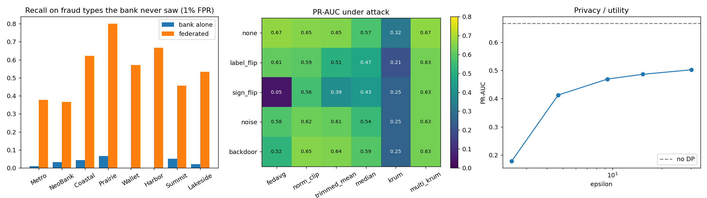

# Federated Fraud Shield

Eight banks train one fraud model together without sharing a single transaction. The system is also hardened against a consortium member who turns malicious and tries to poison it.

Fraud rings hit one bank, learn what works, then move on to the next. Every bank sees only its own slice, and privacy law stops them pooling raw data. Federated learning lets them share what their models learn instead. That opens three questions this project answers with code and measurements:

1. **Does it help?** Yes. Each bank catches fraud types it has never seen.
2. **What if a member is malicious?** Robust aggregation stops poisoning and backdoors.
3. **How private is it?** DP-SGD with a Rényi accountant puts a number (ε) on the leakage, and secure aggregation hides individual updates from the server.

## Setup

- **8 banks** of different sizes (1,500–9,000 training rows), with different customer bases (covariate shift).
- **5 fraud typologies:** card testing, account takeover, card-not-present fraud, merchant bust-out, skimming.
- **Each bank has seen only 2 typologies** in its training data. Every bank's test set has all 5, which is what happens when a ring migrates.
- Global feature normalisation is computed from per-bank sums, so no bank reveals rows even for preprocessing.

## Results

Full suite: `python -m fedshield experiments` (30 rounds, ~11 minutes on a laptop CPU). Tables are written to `results/`.



### Value of federation

| Bank | Typologies seen | Alone PR-AUC | Federated PR-AUC | Alone: recall on unseen fraud | Federated: recall on unseen fraud |
|---|---|---|---|---|---|
| Metro Retail Bank | card testing, ATO | 0.442 | **0.725** | 0.01 | **0.38** |
| NeoBank | ATO, CNP | 0.347 | **0.615** | 0.03 | **0.37** |
| Coastal Cooperative | skimming, card testing | 0.285 | **0.673** | 0.04 | **0.62** |
| Prairie Credit Union | bust-out, skimming | 0.277 | **0.708** | 0.07 | **0.80** |
| Wallet Pay | CNP, bust-out | 0.249 | **0.572** | 0.00 | **0.57** |
| Harbor Savings | ATO, skimming | 0.285 | **0.697** | 0.00 | **0.67** |
| Summit Card Services | card testing, CNP | 0.340 | **0.676** | 0.05 | **0.46** |
| Lakeside Bank | bust-out, ATO | 0.323 | **0.714** | 0.02 | **0.53** |

Recall is measured at a 1% false-positive rate. Global PR-AUC is **0.667** federated, against **0.705** for the centralised upper bound (everyone's raw data pooled, which regulators will not allow). The smallest bank gains the most.

### Two of eight banks malicious

PR-AUC of the global model:

| Attack \ Aggregator | FedAvg | Norm clip | Trimmed mean | Median | Krum | Multi-Krum |
|---|---|---|---|---|---|---|
| none | 0.667 | 0.654 | 0.649 | 0.573 | 0.320 | 0.665 |
| label flip | 0.609 | 0.595 | 0.507 | 0.471 | 0.205 | **0.632** |
| sign flip (boosted) | **0.050** | 0.560 | 0.393 | 0.430 | 0.254 | **0.632** |
| random noise | 0.578 | 0.622 | 0.610 | 0.543 | 0.254 | **0.632** |
| backdoor (boosted) | 0.520 | 0.654 | 0.645 | 0.587 | 0.254 | **0.632** |

Backdoor success, measured as extra triggered fraud let through compared with a clean model:

| Attack \ Aggregator | FedAvg | Norm clip | Trimmed mean | Median | Krum | Multi-Krum |
|---|---|---|---|---|---|---|
| backdoor | +41% | +39% | +31% | +23% | +15% | **+3%** |

Takeaways:
- Plain FedAvg is destroyed by a single boosted sign-flip.
- Krum is robust but throws away most of the honest signal on non-IID data.
- Multi-Krum keeps clean accuracy and neutralises every attack tested.

The backdoor trigger uses two fields that carry no fraud signal on their own (amount ending in .99, unusual client fingerprint entropy). That makes it invisible in clean accuracy, which is what makes backdoors dangerous.

### Privacy

| DP noise multiplier | ε (δ = 1e-5) | PR-AUC |
|---|---|---|
| 0 (off) | ∞ | 0.667 |
| 0.6 | 30.2 | 0.502 |
| 0.8 | 15.3 | 0.486 |
| 1.0 | 9.3 | 0.469 |
| 1.5 | 4.7 | 0.413 |
| 2.5 | 2.4 | 0.178 |

Each bank runs DP-SGD locally:
- per-example gradients via `torch.func.vmap`, clipped to norm 1
- Gaussian noise added
- Poisson sampling, so the accountant's assumptions hold

ε comes from the RDP of the sampled Gaussian mechanism at integer orders (Mironov et al., 2019), composed over every local step and converted to (ε, δ). It is reported per bank, worst case.

**Secure aggregation:**
- Each pair of banks agrees on a key with X25519 and derives a fresh mask per round via HKDF.
- Updates are fixed-point encoded mod 2⁴⁸, so the masks cancel exactly. The server sees only the sum.
- The final PR-AUC matches plain FedAvg within quantisation error (0.664 vs 0.667), and the overhead is negligible.

Secure aggregation and robust aggregation conflict: Krum or the median need to see individual updates. The code refuses that combination. Use FedAvg with client-side norm clipping when updates must stay hidden.

### On real card transactions

`python -m fedshield realdata --data creditcard.pq` runs the same federation on the [ULB / Worldline card-fraud data](https://api.openml.org/d/1597): 284,807 real card transactions, 492 frauds. Results are in `results/real_data.json`.
- **How the banks are formed.** No multi-bank dataset is public. Transactions are clustered by behaviour and each cluster is shared out unevenly (Dirichlet α = 0.5), so every bank gets its own customer mix, size and fraud rate.
- **How it is tested.** Each bank trains on the first 60% of the two days and is tested on the rest. There are no fraud typologies or backdoor-trigger fields in this data, so those two measurements don't apply.

| Bank | Train rows / frauds | Test frauds | Alone PR-AUC | Federated PR-AUC |
|---|---|---|---|---|
| Bank 1 | 28,953 / 46 | 29 | 0.708 | **0.796** |
| Bank 2 | 23,404 / 41 | 19 | 0.702 | **0.728** |
| Bank 3 | 17,008 / 40 | 24 | 0.765 | **0.771** |
| Bank 4 | 21,767 / 29 | 15 | 0.713 | **0.745** |
| Bank 5 | 39,210 / 113 | 27 | 0.684 | **0.773** |
| Bank 6 | 14,779 / 14 | 6 | **0.667** | 0.613 |
| Bank 7 | 8,280 / 18 | 3 | 0.668 | **0.674** |
| Bank 8 | 17,481 / 59 | 9 | 1.000 | 1.000 |

Two of eight banks malicious, global PR-AUC:

| Attack | FedAvg | Trimmed mean | Median | Multi-Krum |
|---|---|---|---|---|
| none | 0.766 | 0.783 | 0.787 | 0.771 |
| label flip | 0.777 | 0.783 | 0.232 | 0.615 |
| sign flip (boosted) | **0.001** | 0.764 | 0.776 | **0.786** |
| random noise | 0.754 | 0.781 | 0.774 | 0.759 |

What the real data shows:
- **Federation helped 6 of 8 banks.** Global PR-AUC is 0.766, against 0.659 for one model trained on everyone's pooled data. That pooled model uses the suite's fixed settings (30 epochs at a lower learning rate) and is untuned, so read it as a reference point, not an upper bound. Per-bank numbers are noisy: the smaller banks have only 3–15 test frauds.
- **One boosted sign-flip destroys plain FedAvg here too** (0.001). Multi-Krum and trimmed mean hold.
- **The choice of robust aggregator depends on the data.** With real fraud this rare, label flipping hardly moves FedAvg, but it wrecks the coordinate-wise median (0.23).
- **Privacy is cheap here.** DP-SGD at ε = 12.3 costs nothing measurable (0.765), and ε = 3.9 costs 0.02 (0.746).
- **Secure aggregation is exact.** Its weights match plain FedAvg to about 10⁻⁶ per round. Over 30 rounds the rounding differences compound and the final PR-AUC lands at 0.746 against 0.765, within the run-to-run spread of so few test frauds.

## Run it

```bash
pip install -r requirements.txt
python -m pytest -q                                   # 9 tests
python -m fedshield run                               # plain FedAvg
python -m fedshield run --attack backdoor --malicious 2 --aggregator multi_krum
python -m fedshield run --dp-sigma 1.0                # with differential privacy
python -m fedshield run --secure-agg --client-clip 5  # masked updates
python -m fedshield experiments [--quick]             # full tables + plot
python -m fedshield realdata --data creditcard.pq     # the federation on real card transactions
streamlit run app.py                                  # interactive simulator
```

The dashboard lets you:
- switch attackers, aggregation rules, DP noise and secure aggregation on and off
- watch PR-AUC and backdoor success round by round
- compare every bank alone against the federation

## Layout

```
fedshield/
  data.py          consortium generator: 8 banks, 5 typologies, covariate shift, backdoor trigger
  realdata.py      the same federation on the real ULB card-fraud data
  model.py         MLP, local SGD and DP-SGD (per-example clipping, Poisson sampling)
  privacy.py       RDP accountant for the sampled Gaussian mechanism
  aggregators.py   FedAvg, norm clipping, trimmed mean, median, Krum, Multi-Krum
  attacks.py       label flip, sign flip, noise, backdoor, model-replacement boosting
  secure_agg.py    X25519 pairwise masking, exact mod-2^48 arithmetic
  federation.py    training loop, evaluation, local-only and centralised baselines
  experiments.py   reproducible experiment suite
app.py             Streamlit simulator
results/           output of the last full run
```

## Moving to production

- The simulation runs everything in one process. For a real consortium, each `train_local` call becomes a bank-side service; [Flower](https://flower.ai) is a good transport. The aggregators, accountant and secure-aggregation code carry over unchanged.
- Secure aggregation here assumes nobody drops out mid-round. The production protocol adds Shamir secret sharing of the mask seeds so the sum can still be recovered when a bank goes offline.
- DP costs real accuracy at small ε, as the table above shows. Larger banks and more rounds of honest data narrow the gap.
