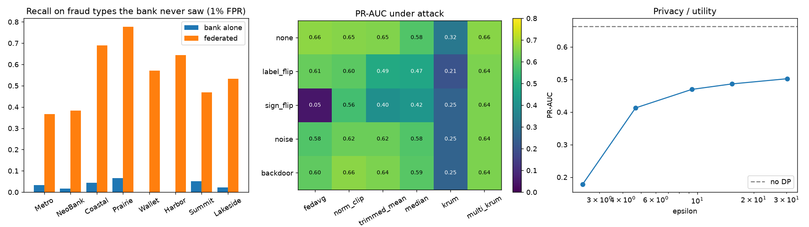

# Evaluation

## Simulated consortium

`python -m fedshield experiments` runs the full suite (30 rounds) and writes the tables to `results/`. The numbers below are from a re-run on the pinned dependencies (torch 2.15); the first run, on older versions, gave the same conclusions with slightly different values. The real-data results further down were not re-run.

Setup: 8 banks of different sizes (1,500–9,000 training rows) and customer mixes, and 5 fraud types (card testing, account takeover, card-not-present, merchant bust-out, skimming). Each bank has seen only 2 fraud types in training, while every test set has all 5, which is what happens when a fraud ring moves to a new bank. Feature normalisation is computed from per-bank sums, so no bank shares rows even for preprocessing.

### Value of federation

| Bank | Fraud types seen | Alone PR-AUC | Federated PR-AUC | Alone: recall on unseen fraud | Federated: recall on unseen fraud |
|---|---|---|---|---|---|
| Metro Retail Bank | card testing, ATO | 0.441 | 0.715 | 0.03 | 0.37 |
| NeoBank | ATO, CNP | 0.351 | 0.617 | 0.02 | 0.38 |
| Coastal Cooperative | skimming, card testing | 0.292 | 0.677 | 0.04 | 0.69 |
| Prairie Credit Union | bust-out, skimming | 0.277 | 0.696 | 0.07 | 0.78 |
| Wallet Pay | CNP, bust-out | 0.249 | 0.570 | 0.00 | 0.57 |
| Harbor Savings | ATO, skimming | 0.285 | 0.693 | 0.00 | 0.64 |
| Summit Card Services | card testing, CNP | 0.340 | 0.672 | 0.05 | 0.47 |
| Lakeside Bank | bust-out, ATO | 0.323 | 0.716 | 0.02 | 0.53 |

Recall is measured at a 1% false-positive rate. The federated global PR-AUC is 0.663, against 0.711 when all raw data is pooled in one place.

### Two of eight banks malicious

Global PR-AUC:

| Attack \ Aggregator | FedAvg | Norm clip | Trimmed mean | Median | Krum | Multi-Krum |
|---|---|---|---|---|---|---|
| none | 0.663 | 0.655 | 0.649 | 0.582 | 0.320 | 0.658 |
| label flip | 0.613 | 0.600 | 0.485 | 0.475 | 0.205 | 0.643 |
| sign flip (boosted) | 0.050 | 0.560 | 0.398 | 0.421 | 0.254 | 0.643 |
| random noise | 0.583 | 0.620 | 0.620 | 0.584 | 0.254 | 0.643 |
| backdoor (boosted) | 0.604 | 0.660 | 0.643 | 0.593 | 0.254 | 0.643 |

Backdoor success, measured as extra triggered fraud let through compared with a clean model: FedAvg +47%, norm clip +27%, trimmed mean +33%, median +25%, Krum +15%, Multi-Krum +5%.

Plain FedAvg is destroyed by one boosted sign-flip attacker. Krum is robust but discards most of the honest signal when banks' data differ. Multi-Krum keeps clean accuracy and resists every attack tested. The backdoor trigger uses two fields with no fraud signal of their own, so it doesn't show up in clean accuracy.

### Privacy

| DP noise multiplier | ε (δ = 1e-5) | PR-AUC |
|---|---|---|
| 0 (off) | ∞ | 0.663 |
| 0.6 | 30.2 | 0.502 |
| 0.8 | 15.3 | 0.486 |
| 1.0 | 9.3 | 0.469 |
| 1.5 | 4.7 | 0.413 |
| 2.5 | 2.4 | 0.178 |

Each bank runs DP-SGD locally with per-example gradients clipped to norm 1, Gaussian noise and Poisson sampling. ε comes from the Rényi DP of the sampled Gaussian mechanism (Mironov et al., 2019), composed over every local step, and is reported for the worst-case bank.

Secure aggregation: each pair of banks agrees on a key with X25519 and derives a fresh mask every round with HKDF. Updates are encoded as fixed-point numbers mod 2^48, so the masks cancel exactly and the server only sees the sum. The final PR-AUC matches plain FedAvg to within 0.006. Masks now come from the ChaCha20 stream cipher (they came from numpy's PCG64 generator, which is not cryptographically secure); since masks cancel exactly, the result doesn't depend on how they are generated.

## Real card transactions

`python -m fedshield realdata --data creditcard.pq` runs the same federation on the [ULB / Worldline card-fraud data](https://api.openml.org/d/1597): 284,807 real card transactions with 492 frauds. Results go to `results/real_data.json`.

No multi-bank dataset is public, so the transactions are clustered by behaviour and each cluster is shared out unevenly between 8 banks (Dirichlet α = 0.5). Each bank trains on the first 60% of the two days and is tested on the rest. This data has no fraud types or backdoor fields, so those measurements don't apply.

| Bank | Train rows / frauds | Test frauds | Alone PR-AUC | Federated PR-AUC |
|---|---|---|---|---|
| Bank 1 | 28,953 / 46 | 29 | 0.708 | 0.796 |
| Bank 2 | 23,404 / 41 | 19 | 0.702 | 0.728 |
| Bank 3 | 17,008 / 40 | 24 | 0.765 | 0.771 |
| Bank 4 | 21,767 / 29 | 15 | 0.713 | 0.745 |
| Bank 5 | 39,210 / 113 | 27 | 0.684 | 0.773 |
| Bank 6 | 14,779 / 14 | 6 | 0.667 | 0.613 |
| Bank 7 | 8,280 / 18 | 3 | 0.668 | 0.674 |
| Bank 8 | 17,481 / 59 | 9 | 1.000 | 1.000 |

Two of eight banks malicious, global PR-AUC:

| Attack | FedAvg | Trimmed mean | Median | Multi-Krum |
|---|---|---|---|---|
| none | 0.766 | 0.783 | 0.787 | 0.771 |
| label flip | 0.777 | 0.783 | 0.232 | 0.615 |
| sign flip (boosted) | 0.001 | 0.764 | 0.776 | 0.786 |
| random noise | 0.754 | 0.781 | 0.774 | 0.759 |

Federation helped 6 of the 8 banks. The global PR-AUC is 0.766, against 0.659 for one model trained on all the data pooled with the same fixed settings (untuned, so a reference point rather than an upper bound). The smaller banks have only 3–15 test frauds, so their individual numbers are noisy.

One boosted sign-flip attacker still destroys plain FedAvg (0.001), while Multi-Krum and trimmed mean hold. With fraud this rare, label flipping hardly affects FedAvg but badly hurts the median (0.23), so the right robust aggregator depends on the data.

Privacy costs little here: DP-SGD at ε = 12.3 makes no measurable difference (0.765), and ε = 3.9 costs 0.02 (0.746). Secure aggregation matches plain FedAvg to about 1e-6 per round; over 30 rounds the rounding adds up to 0.746 against 0.765, within the run-to-run spread.
